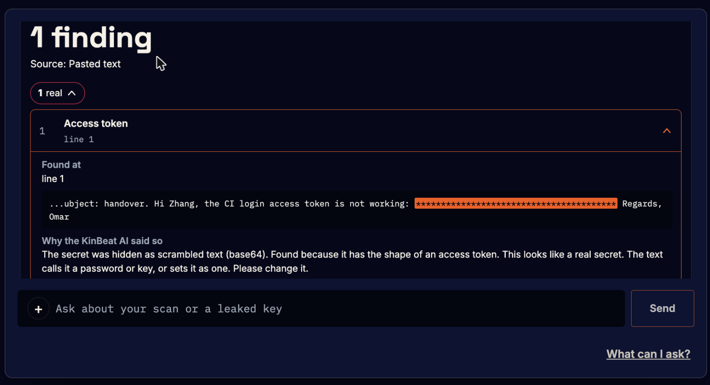
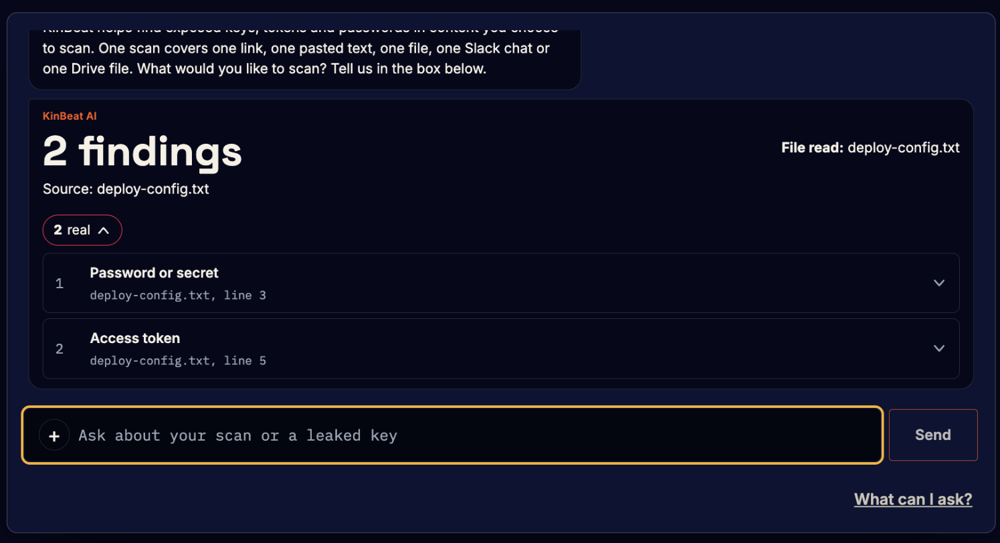
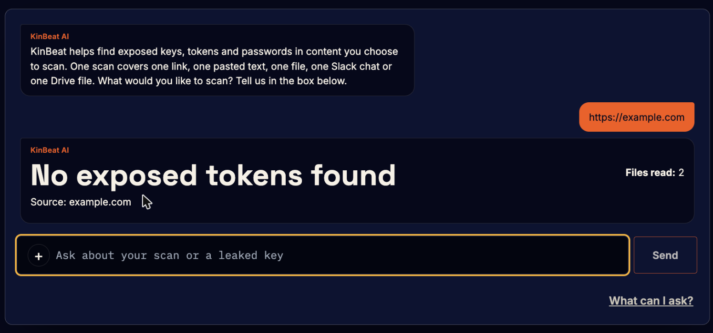
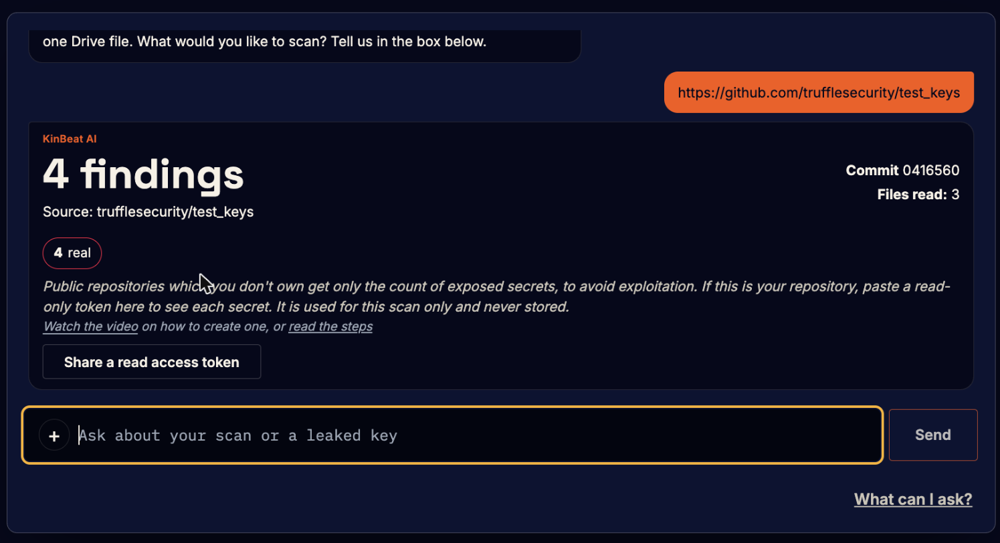
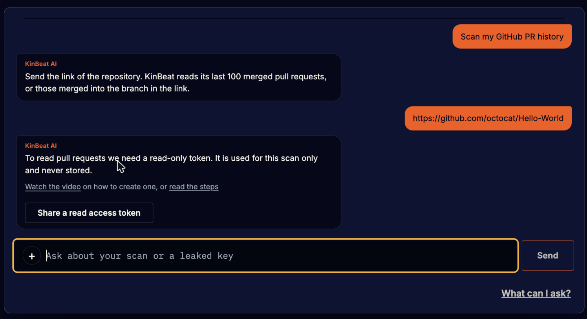
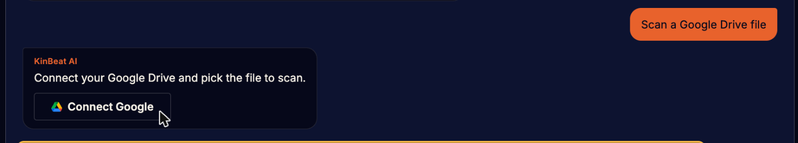
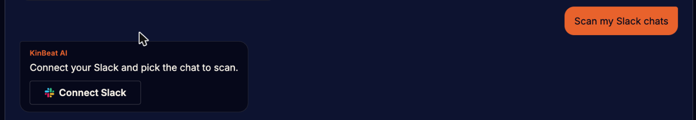
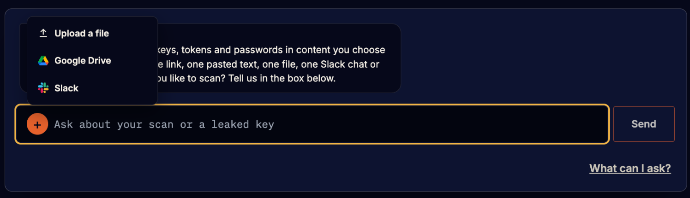
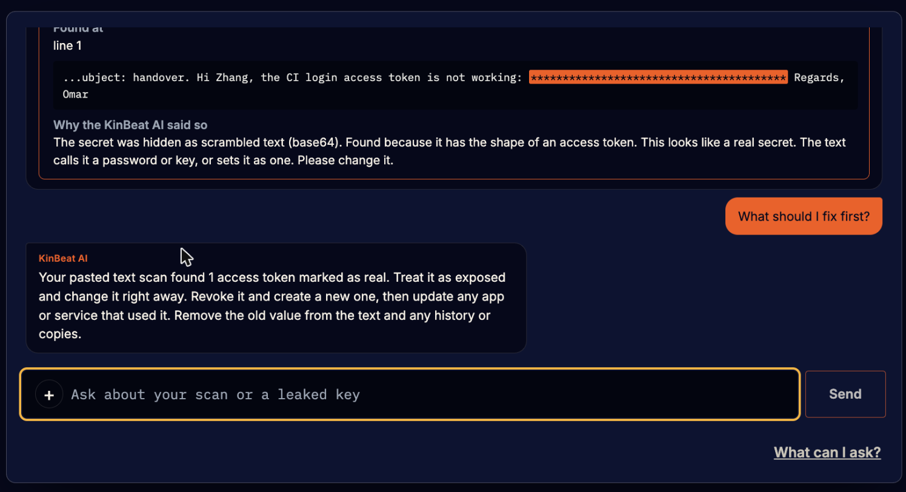

# KinBeat

**Find your exposed tokens before hackers do.** KinBeat reads the places where secrets leak - chats, files, websites, GitHub, Google Drive and Slack - and tells you which keys are real and which are only possible.

Demo video: _[link coming]_

The project can be cloned and run locally (see below). For the complete experience, with the Google Drive and Slack connections and the live AI judge, visit **https://kinbeat.com**.

Built during the Meta Global AI Developer Hackathon, Indie track, by one developer, between 26 October and 4 November 2026.

## What KinBeat can do

**Scan a chat you paste.** Teams leak keys in messages all the time. Paste the text and KinBeat finds the key, even when it is scrambled (base64, hex, URL codes), spelled out letter by letter, written in NATO code words or number words, or split over two messages.



**Scan a file.** PDFs, Word files, zips, code and config files. Screenshots and scanned pages are read as text, so a key inside a picture is found too.



**Scan a website.** Paste any page link.



**Scan a GitHub repository.** Paste the link. Public repositories you do not own get only the count of exposed secrets, so nobody can use KinBeat to raid them. With a read-only token for your own repository you see every finding, file and line.



**Scan your GitHub pull request history.** Up to 100 merged pull requests, with the pull request, file and line of each secret.



**Scan a Google Drive file.** Press + in the chat box, choose Google Drive, sign in and pick one file.



**Scan your Slack chats.** Press + in the chat box, choose Slack, connect your workspace and pick a channel from the list. Up to 10,000 messages per scan.



The + menu in the chat box holds all three: Upload a file, Google Drive, Slack.



**Ask KinBeat AI.** The AI has been through evals to tell a real key from an example key, so you can fix the real ones first. You can also ask it about a leaked AWS key, how to change one, what a JWT is, and more.



## Under the hood, in one breath

A multimodal AI that reads text, pictures and scanned pages; a judge that marks each finding real, possible or example with a one-sentence reason; a validation layer that checks every AI answer before it is shown; retrieval of this scan's findings into every answer; and an eval suite that scores the whole thing. Latest live run: 98.9%.

## Try it

The full experience is at https://kinbeat.com: the real Muse judge, Google Drive, Slack and the live scan counts.

During the hackathon the site keeps no accounts and no scan results. There is no sign-in on purpose, so judges can try every scan without creating anything.

## Run it locally

Needs Node 22.13 or newer. Postgres is optional.

```bash
npm install && cp .env.example .env && npm run dev
```

- Open `https://localhost:3001`. One command starts the API and the web page. Accept the local certificate if the browser asks.
- Without `MODEL_API_KEY` the app runs a simple mock judge, and every result says `mode: mock`. Put your Muse key in `.env` to use the real model.
- Google Drive needs the three `NEXT_PUBLIC_GOOGLE_` values in `.env`. Slack needs your own Slack app, made from `slack-manifest.yaml`, with its `SLACK_CLIENT_ID` and `SLACK_CLIENT_SECRET`.
- Evals: `npm run eval` in `api` (mock), or `EVAL_LIVE=1 npm run eval` with a Muse key.

## Meta model

- Meta's Muse Spark Open is the only model that makes decisions at runtime, served on a partner endpoint (Modal). `MODEL_API_BASE_URL` and `MODEL_API_MODEL` in `.env` choose the endpoint and the model.
- Because every decision at runtime is made by a Meta open-weight model, the project also qualifies for Best Build on Meta Open Weight Models.

## Open-source software used

- Server: NestJS, `pg`, `dotenv`, `jszip`, `mammoth`, `pdfjs-dist`, `@napi-rs/canvas`, RxJS.
- Web: Next.js, React.

Legal: https://kinbeat.com/privacy and https://kinbeat.com/terms.
